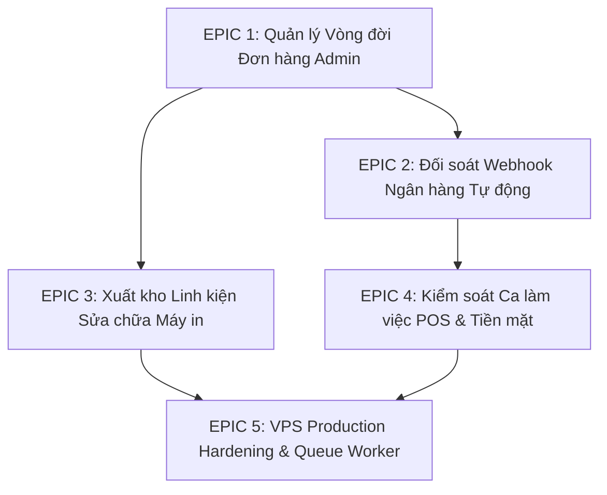

# HỒ SƠ ĐẶC TẢ KỸ THUẬT & LỘ TRÌNH PHÁT TRIỂN DỰ ÁN (SPEC.MD)
## HỆ THỐNG QUẢN TRỊ BÁN LẺ VĂN PHÒNG PHẨM & DỊCH VỤ SỬA CHỮA MÁY IN
*Phiên bản đặc tả: 2.0 (Milestone 2 - Fulfillment, Webhook & Inventory Automation)*  
*Chuẩn phát triển: AgentFlow SDLC + Tuân thủ nghiêm ngặt [AGENTS.md](file:///e:/code/van_phong_pham/vpp/AGENTS.md)*

---

## 1. TỔNG QUAN HỆ THỐNG & MỤC TIÊU KỸ THUẬT

### 1.1. Bối cảnh & Mục tiêu kinh doanh
Hệ thống phục vụ cửa hàng kinh doanh văn phòng phẩm (~1.000 SKU) kết hợp trung tâm dịch vụ sửa chữa, thay thế linh kiện, nạp mực máy in văn phòng (Canon, HP, Brother, Epson...).

* **Bán lẻ tại quầy (POS):** Lên đơn nhanh dưới 60 giây, hỗ trợ quét mã vạch, tự động trừ kho theo đơn vị quy đổi kép (bán lẻ theo Ram giấy hoặc bán sỉ theo Thùng 5 Ram).
* **Bán hàng Online (Storefront):** Khách hàng đặt mua nhanh (Guest Checkout không bắt buộc đăng ký tài khoản), hiển thị Flash Sale thời gian thực, quét mã VietQR động tự động nhận diện thanh toán.
* **Dịch vụ tiếp nhận máy in (Repair Intake):** Hỗ trợ 2 nhánh tiếp nhận linh hoạt (báo giá ngay hoặc tiếp nhận trước chẩn đoán sau), in phiếu hẹn dán vỏ máy và phiếu giao khách.
* **Tra cứu công khai chống IDOR (`/tra-cuu`):** Tra cứu đa năng cả Hóa đơn bán lẻ (`HD...`) và Phiếu sửa chữa (`SC...`), bảo mật 2 lớp thông qua Mã định danh + 4 số cuối Số điện thoại.
* **In ấn chuẩn văn phòng:** Định dạng chuyên dụng cho máy in A4 (chia đôi 2 liên cuống giao khách / cuống lưu), A5 bán lẻ và K80 máy in nhiệt.

### 1.2. Nền tảng công nghệ & Môi trường thực thi
* **Backend Framework:** Laravel 12/13 chạy trên PHP 8.3+.
* **Giao diện quản trị (Admin & POS):** Filament PHP v3 (Livewire 3 + Tailwind CSS + Alpine.js).
* **Giao diện Storefront:** Laravel Blade Template + Vanilla CSS & Tailwind CSS hiện đại.
* **Cơ sở dữ liệu:**
  * Production: MySQL 9.1 (InnoDB, hỗ trợ đầy đủ Foreign Key Constraints & Transactions).
  * Kiểm thử tự động (Testing): SQLite in-memory (Yêu cầu mã nguồn viết theo chuẩn Database Agnostic, không dùng hàm đặc thù của MySQL trực tiếp trong query builder).
* **Quy chuẩn chất lượng:** 100% bài kiểm tra tự động phải PASS (`php artisan test` 114/114 passing, 800 assertions).

---

## 2. QUY CHUẨN KỸ THUẬT BẮT BUỘC (CORE DIRECTIVES THEO AGENTS.MD)

1. **Nguyên tắc "Không rõ phải hỏi - Cấm code bừa" (Zero Guesswork):**
   * Tuyệt đối không suy đoán nghiệp vụ dòng tiền, tỷ lệ chiết khấu, phương thức trừ kho. Phải làm rõ trước khi cài đặt.
2. **Nguyên tắc DRY & Dependency Lean:**
   * Không lặp code; tách logic dùng chung vào `app/Services/` và `app/Helpers/AppHelper.php`.
   * Cấm cài đặt các package composer/npm nặng nề nếu chức năng có thể tự viết dưới 50 dòng code thuần PHP/JS.
3. **Kiểm soát & Làm sạch dữ liệu đầu vào (Strict Validation & Sanitization):**
   * Lớp 1 (Client-side) kiểm tra tức thì; Lớp 2 (Server-side) bắt buộc validate mọi request.
   * Số điện thoại: làm sạch `preg_replace('/\D/', '', $phone)` và trích xuất chuẩn `phone_last4`.
4. **Bảo mật Chống IDOR (Insecure Direct Object References):**
   * Các route công khai tuyệt đối không dùng ID số tuần tự. Bắt buộc dùng UUID hoặc `Mã phiếu / Mã đơn + 4 số cuối SĐT`.
5. **Giao diện 100% Tiếng Việt chuẩn mực:**
   * Toàn bộ nhãn, nút bấm, thông báo toast, modal xác nhận phải bằng tiếng Việt trong sáng, không dùng tiếng Anh nửa vời.
   * Thiết kế Mobile-First (vùng bấm tối thiểu 44px, bottom navigation ghim chân trang).
6. **Toàn vẹn Tồn kho & Tài chính (Database Transaction):**
   * Mọi thao tác làm thay đổi tiền tệ hoặc biến động tồn kho **BẮT BUỘC PHẢI BỌC TRONG `DB::transaction(function() { ... })`**. Rollback 100% nếu có bất kỳ bước nào thất bại.
   * Truy vấn quan hệ cha-con bắt buộc dùng Eager Loading `->with([...])` để triệt tiêu lỗi N+1 Query.

---

## 3. HIỆN TRẠNG HỆ THỐNG ĐÃ HOÀN TẤT (BASELINE CHECKPOINT)

| Phân hệ / Tính năng | Mô tả chi tiết | Tệp nguồn cốt lõi | Trạng thái |
| :--- | :--- | :--- | :--- |
| **Storefront & Flash Sale** | Trang chủ hiển thị 16 sản phẩm Flash Sale dạng Slider, bán chạy, danh mục chips | `resources/views/storefront/index.blade.php` | ✅ Hoàn thành |
| **Chi tiết sản phẩm** | Trang sản phẩm chuẩn SEO, thông số kỹ thuật, Mobile Bottom Bar mua hàng | `resources/views/storefront/product-detail.blade.php` | ✅ Hoàn thành |
| **Thanh toán VietQR động** | Polling thời gian thực kiểm tra giao dịch, tự đồng bộ giá khuyến mãi Flash Sale | `resources/views/storefront/checkout.blade.php` | ✅ Hoàn thành |
| **Tra cứu Đa năng (`/tra-cuu`)** | Tra cứu đồng thời Đơn hàng và Phiếu sửa chữa, bảo mật 2 lớp chống IDOR | `app/Http/Controllers/LookupController.php` | ✅ Hoàn thành |
| **Giao diện Tiến độ Đơn hàng** | Thanh tiến độ 4 bước trực quan, VietQR thanh toán bổ sung, che mờ SĐT | `resources/views/lookup/order-show.blade.php` | ✅ Hoàn thành |
| **Mẫu In Hóa đơn Đa khổ** | In A5 bán lẻ, A4 chia đôi 2 liên có đường cắt rời, K80 in nhiệt, mã QR tra cứu | `resources/views/print/order.blade.php` | ✅ Hoàn thành |
| **Bộ Kiểm thử Tự động** | 114 tests kiểm thử hồi quy toàn diện, 800 assertions đạt 100% | `tests/Feature/LookupSystemTest.php`, ... | ✅ Hoàn thành |

---

## 4. CHI TIẾT CÁC PHÂN HỆ PHÁT TRIỂN TIẾP THEO (EPICS & USER STORIES)

---

### EPIC 1: QUẢN LÝ VÒNG ĐỜI ĐƠN HÀNG TRONG FILAMENT ADMIN (ORDER FULFILLMENT)
*Mục tiêu: Giúp nhân viên thu ngân/quản trị viên xử lý đơn hàng online từ lúc tiếp nhận đến khi giao thành công, đảm bảo tồn kho tự động trừ và hoàn trả chính xác.*

#### Yêu cầu chi tiết:
1. **Luồng trạng thái đơn hàng (`orders.status`):**
   * `pending` (Chờ xác nhận) $\rightarrow$ `processing` (Đang chuẩn bị hàng / đóng gói) $\rightarrow$ `shipping` (Đang giao hàng) $\rightarrow$ `delivered` (Giao thành công) $\rightarrow$ `cancelled` (Hủy đơn).
2. **Cơ chế trừ và hoàn tồn kho:**
   * Khi đơn hàng chuyển từ `pending` sang `processing` (hoặc `delivered`), hệ thống tự động trừ số lượng sản phẩm trong bảng `products.stock_quantity`. Nếu sản phẩm bán theo đơn vị quy đổi kép (`product_units`), số lượng trừ = `quantity * conversion_rate`.
   * Khi đơn hàng chuyển sang `cancelled`: Tự động hoàn lại số lượng tồn kho tương ứng nếu đơn đó trước đó đã bị trừ kho.
   * **Bắt buộc:** Toàn bộ logic cập nhật trạng thái và biến động kho phải bọc trong `DB::transaction()`.
3. **In ấn đơn hàng trực tiếp:**
   * Thêm nút hành động (Action) "In đơn hàng" trực tiếp trên bảng `OrderResource` trong Filament: Mở popup chọn khổ in (A4 2 liên, A5, K80) và in ngay.
4. **Thông tin vận chuyển:**
   * Bổ sung trường quản lý đơn vị vận chuyển (`shipping_carrier`) và mã vận đơn (`tracking_code`) để nhân viên theo dõi tiến độ giao hàng.

---

### EPIC 2: TỰ ĐỘNG HÓA ĐỐI SOÁT WEBHOOK NGÂN HÀNG (SEPAY / CASSO AUTO-RECONCILIATION)
*Mục tiêu: Tự động ghi nhận tiền vào tài khoản ngân hàng từ cổng SePay / Casso, đối soát đúng đơn hàng hoặc phiếu sửa chữa trong 3-5 giây.*

#### Yêu cầu chi tiết:
1. **Bảo mật Webhook:**
   * Xác thực Webhook thông qua Secret API Key / Bearer Token trong header request.
   * Chống tấn công Replay Attack & Ghi nhận trùng lặp (Idempotency): Kiểm tra trường `transaction_id` của ngân hàng trong bảng `payment_transactions`. Nếu đã tồn tại, trả về HTTP 200 ngay lập tức mà không cộng tiền lặp lại.
2. **Giải mã mã giao dịch (Reference Parser):**
   * Nhận diện mã hóa đơn VPP: Regex tìm kiếm `HD[0-9]+` hoặc `VPP[0-9]+` trong nội dung chuyển khoản (`description`).
   * Nhận diện mã phiếu sửa chữa: Regex tìm kiếm `SC[0-9]+`.
3. **Cập nhật trạng thái thanh toán tự động trong `DB::transaction()`:**
   * Khớp Đơn hàng: Cập nhật `orders.payment_status = 'paid'`, `orders.paid_amount = payment_amount`. Nếu đơn đang `pending`, tự động đẩy sang `processing`.
   * Khớp Phiếu sửa chữa: Cập nhật `repair_tickets.payment_status = 'paid'`, `repair_tickets.paid_amount = payment_amount`.
   * Lưu bản ghi lịch sử vào bảng `payment_transactions` kèm đầy đủ `raw_payload`.

---

### EPIC 3: XUẤT KHO TỰ ĐỘNG LINH KIỆN SỬA CHỮA MÁY IN (REPAIR PARTS INVENTORY LINK)
*Mục tiêu: Đảm bảo một kho sản phẩm duy nhất được đồng bộ hóa giữa bán lẻ văn phòng phẩm và xuất vật tư sửa chữa máy in.*

#### Yêu cầu chi tiết:
1. **Liên kết vật tư sửa chữa:**
   * Mỗi dòng linh kiện trong `repair_items` có thể gắn với một `product_id` trong danh mục sản phẩm (với điều kiện `products.is_service_part = true` hoặc hàng hóa thông thường).
2. **Cơ chế trừ kho vật tư:**
   * Khi phiếu tiếp nhận chuyển sang trạng thái `in_progress` (Thợ đang tiến hành thay thế) hoặc `completed`: Tự động trừ tồn kho các linh kiện tương ứng.
   * Nếu khách hàng từ chối sửa (`cancelled`): Tự động hoàn lại linh kiện về kho.
   * Kiểm tra tồn kho trước khi duyệt xuất linh kiện: Nếu số lượng tồn kho không đủ, hiển thị thông báo cảnh báo rõ ràng cho kỹ thuật viên.

---

### EPIC 4: QUẢN LÝ CA LÀM VIỆC POS & ĐỐI SOÁT TIỀN MẶT (POS SHIFTS & CASH RECONCILE)
*Mục tiêu: Kiểm soát dòng tiền thu ngân tại quầy, ngăn ngừa thất thoát và sai lệch sổ sách cuối ngày.*

#### Yêu cầu chi tiết:
1. **Quy trình Mở ca / Đóng ca (`pos_shifts`):**
   * Bắt đầu ca: Thu ngân nhập số tiền mặt đầu ca (`opening_cash`).
   * Kết thúc ca: Thu ngân nhập số tiền mặt thực tế kiểm đếm lúc bàn giao (`closing_cash_actual`).
2. **Đối soát tự động:**
   * Hệ thống tự động tính toán: Doanh thu tiền mặt (`cash_sales`), Doanh thu chuyển khoản VietQR (`vietqr_sales`), Doanh thu công nợ (`debt_sales`).
   * Tính chênh lệch: `difference = closing_cash_actual - (opening_cash + cash_sales)`. Ghi nhận lý do giải trình nếu có sai lệch.
3. **In phiếu kết ca:**
   * Xuất báo cáo kết ca khổ K80 / A5 tóm tắt đầy đủ tổng số hóa đơn, số phiếu sửa chữa đã thu tiền và chi tiết các khoản thu.

---

### EPIC 5: VPS PRODUCTION HARDENING, QUEUE WORKER & SAO LƯU HỆ THỐNG
*Mục tiêu: Đảm bảo hệ thống vận hành ổn định trên máy chủ VPS, tối ưu tải và an toàn dữ liệu tuyệt đối.*

#### Yêu cầu chi tiết:
1. **Xử lý ảnh nền bất đồng bộ (Queue Worker):**
   * Cấu hình Supervisor giám sát tiến trình `php artisan queue:work` trên VPS để nén ảnh sang định dạng WebP không làm nghẽn request của người dùng.
2. **Chiến lược Bộ nhớ đệm (Caching Strategy):**
   * Cache cây danh mục ngành hàng (`Category::tree()`) và bảng dòng máy in tương thích (`PrinterModel`) trong 24 giờ.
   * Tự động xóa cache (Cache Invalidation) khi có thao tác Create/Update/Delete trong Filament Admin.
3. **Sao lưu tự động (Automated Backup):**
   * Thiết lập Cron job hàng đêm tự động xuất bản sao lưu cơ sở dữ liệu MySQL và thư mục lưu trữ `storage/app/public`.

---

## 5. MA TRẬN PHỤ THUỘC & ĐỘ ƯU TIÊN (TRANSITIVE PRIORITY MATRIX)

Theo chuẩn AgentFlow, nhiệm vụ nào giải phóng (unblock) nhiều tác vụ phía sau nhất sẽ được chỉ định độ ưu tiên cao nhất:

| Mã Task | Tên tác vụ | Phụ thuộc vào | Tác vụ bị chặn phía sau | Độ ưu tiên chuyển giao |
| :--- | :--- | :--- | :--- | :--- |
| **TSK-01** | Order Fulfillment State Machine & DB::transaction Trừ/Hoàn Kho | Baseline Checkpoint | TSK-02, TSK-04 | **P0 (Cao nhất - Unblocks 2)** |
| **TSK-02** | Filament Order Print Action & Giao diện Đóng gói | TSK-01 | TSK-08 | **P1 (Quan trọng)** |
| **TSK-03** | Webhook SePay/Casso Idempotent & Security Layer | Baseline Checkpoint | TSK-04 | **P1 (Quan trọng)** |
| **TSK-04** | Webhook Auto-Reconciliation cho Đơn hàng & Phiếu sửa chữa | TSK-01, TSK-03 | TSK-07 | **P1 (Quan trọng)** |
| **TSK-05** | Repair Parts Inventory Link & Tự động xuất kho linh kiện | Baseline Checkpoint | TSK-06 | **P1 (Quan trọng)** |
| **TSK-06** | Cảnh báo hết linh kiện sửa chữa & Khóa xuất kho âm | TSK-05 | TSK-08 | **P2 (Trung bình)** |
| **TSK-07** | Báo cáo đối soát Ca làm việc POS (PosShift Reconcile) | TSK-04 | TSK-08 | **P2 (Trung bình)** |
| **TSK-08** | VPS Hardening, Queue Worker Supervisor & Auto Backup | TSK-02, TSK-06, TSK-07 | Sẵn sàng bàn giao | **P3 (Tích hợp cuối)** |

---

## 6. TIÊU CHUẨN KIỂM DUYỆT (QUALITY ASSURANCE GATES)

Mọi công việc phải vượt qua 4 cổng kiểm duyệt trước khi được coi là hoàn tất:

1. **Gate 1 - Build to Review (Deterministic Gate):**
   * Cú pháp PHP sạch sẽ (`php -l` không có lỗi).
   * Không có hardcoded query hoặc vi phạm quy chuẩn `AGENTS.md`.
2. **Gate 2 - Review to Test (Adversarial Review):**
   * Người đánh giá (Reviewer) bắt buộc phải chỉ ra **tối thiểu 3 nguy cơ / điểm cần lưu ý** về:
     - An toàn dữ liệu & Chống IDOR.
     - Tính toàn vẹn tồn kho và tiền tệ trong `DB::transaction()`.
     - Trải nghiệm giao diện tiếng Việt & Mobile-first.
3. **Gate 3 - Test to Integrate:**
   * Toàn bộ test suite phải vượt qua 100% (`php artisan test`).
   * Bổ sung Feature Test cho từng luồng nghiệp vụ mới.
4. **Gate 4 - Integrate to Done:**
   * Merge vào nhánh `master` không có xung đột mã nguồn.
   * Kiểm thử hồi quy toàn bộ hệ sinh thái không có lỗi phát sinh.
