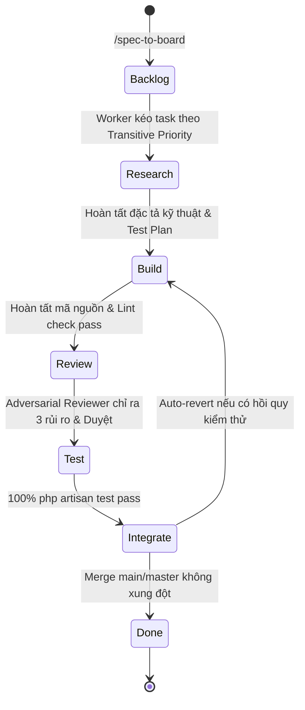

# BẢNG KANBAN 7 GIAI ĐOẠN AGENTFLOW (AGENTFLOW KANBAN BOARD)
## HỆ THỐNG QUẢN TRỊ BÁN LẺ VĂN PHÒNG PHẨM & DỊCH VỤ SỬA CHỮA MÁY IN
*Tài liệu điều phối phát triển tự động hóa đa Agent theo phương pháp AgentFlow*  
*Tích hợp chuẩn kỹ thuật: [AGENTS.md](file:///e:/code/van_phong_pham/vpp/AGENTS.md) & [SPEC.md](file:///e:/code/van_phong_pham/vpp/SPEC.md)*

---

## 1. MÔ HÌNH TRẠNG THÁI 7 GIAI ĐOẠN (THE 7-STAGE PIPELINE)

Bảng Kanban đóng vai trò là **Bộ máy trạng thái phân tán (Distributed State Machine)**. Mọi Agent tham gia phát triển đều đọc và cập nhật trạng thái nhiệm vụ trực tiếp trên bảng này.



---

## 2. NGUYÊN TẮC VẬN HÀNH CỐT LÕI (CORE RULES)

### 2.1. Cổng Kiểm Soát Quyết Định Luận (Deterministic Before Probabilistic)
* **Quy tắc:** Cổng kiểm thử tự động cứng (`php artisan test`, cú pháp PHP sạch `php -l`) bắt buộc phải chạy và đạt **100% PASS** trước khi giao cho Agent AI review. Điều này lọc sạch 60-70% lỗi cú pháp và logic cơ bản với chi phí token gần như bằng 0.

### 2.2. Đánh Giá Phản Biện Bắt Buộc (Adversarial Review)
* **Quy tắc:** Agent thực hiện Reviewer **BẮT BUỘC PHẢI CHỈ RA TỐI THIỂU 3 ĐIỂM RỦI RO HOẶC HẠN CHẾ** của mã nguồn trước khi cấp quyền thông qua:
  1. *Rủi ro Bảo mật:* Lỗ hổng IDOR, thiếu sanitize dữ liệu, SQL injection.
  2. *Rủi ro Tài chính & Kho:* Thao tác trừ tiền hoặc kho thiếu `DB::transaction()`, nguy cơ số lượng âm.
  3. *Rủi ro Trải nghiệm & Chuẩn mực:* Lệch chuẩn Mobile-First (vùng bấm < 44px), lỗi in ấn `@media print`, dùng từ tiếng Anh nửa vời.

### 2.3. Điều Phối Ưu Tiên Chuyển Giao (Transitive Priority Dispatch)
* **Quy tắc:** Tác vụ nào giải phóng (unblock) nhiều tác vụ hạ nguồn nhất sẽ được kéo vào làm việc trước:
  $$\text{Priority Score} = 1 + \sum \text{Downstream Dependent Tasks}$$

### 2.4. Khôi Phục Sự Cố & Chống Treo Máy (Crash-Proof Orchestration)
* **Bộ quét định kỳ không trạng thái (Stateless Crontab Sweep):** Bộ điều phối quét trạng thái mỗi 15 phút (`*/15 * * * *`). Nếu Agent bị ngắt kết nối hoặc hết phiên, bộ quét tự động đọc lại trạng thái từ bảng Kanban.
* **Dead Agent Detection:** Nếu một tác vụ không có cập nhật trong 10 phút, tự động giải phóng khóa (lock) và đưa task trở lại hàng đợi `Backlog`.
* **Auto-revert:** Nếu bước `Integrate` làm hỏng test suite chung, hệ thống tự động chạy `git revert` và tạo commit mới, tuyệt đối không dùng force-push.

---

## 3. BẢNG TRẠNG THÁI HIỆN TẠI (CURRENT KANBAN BOARD)

```
┌──────────────┬──────────────┬──────────────┬──────────────┬──────────────┬──────────────┬──────────────┐
│   BACKLOG    │   RESEARCH   │    BUILD     │    REVIEW    │     TEST     │  INTEGRATE   │     DONE     │
├──────────────┼──────────────┼──────────────┼──────────────┼──────────────┼──────────────┼──────────────┤
│ [CARD-010]   │              │ [CARD-009]   │              │              │              │ [CARD-001]   │
│ [CARD-011]   │              │              │              │              │              │ [CARD-002]   │
│              │              │              │              │              │              │ [CARD-003]   │
│              │              │              │              │              │              │ [CARD-004]   │
│              │              │              │              │              │              │ [CARD-005]   │
│              │              │              │              │              │              │ [CARD-006]   │
│              │              │              │              │              │              │ [CARD-007]   │
│              │              │              │              │              │              │ [CARD-008]   │
└──────────────┴──────────────┴──────────────┴──────────────┴──────────────┴──────────────┴──────────────┘
```

---

## 4. CHI TIẾT THẺ NHIỆM VỤ (TASK CARDS DETAIL)

### 4.1. CÁC NHIỆM VỤ ĐÃ HOÀN TẤT (DONE)

#### `[CARD-001]` Trang chi tiết sản phẩm chuẩn SEO & Mobile Sticky Action Bar
* **Phân hệ:** Storefront & SEO Catalog
* **Trạng thái:** `DONE` (Commit `e1f9c14`)
* **Kiểm định:** Đầy đủ Meta SEO, JSON-LD Schema, thanh mua hàng di động 44px min.

#### `[CARD-002]` Thanh toán tự động kiểm tra VietQR thời gian thực & Khớp giá Flash Sale
* **Phân hệ:** Checkout & Real-time Polling
* **Trạng thái:** `DONE` (Commit `113f4cf`)
* **Kiểm định:** API `/don-hang/kiem-tra-thanh-toan/{orderCode}`, pháo hoa chúc mừng, đồng bộ tồn kho.

#### `[CARD-003]` Hệ thống Tra cứu toàn diện (`/tra-cuu`) đa năng chống IDOR
* **Phân hệ:** Customer Service & Anti-IDOR Security
* **Trạng thái:** `DONE` (Commit `e27e1a4`)
* **Kiểm định:** Nhận diện cả `HD...` và `SC...`, xác thực 2 lớp qua 4 số cuối SĐT.

#### `[CARD-004]` In ấn hóa đơn / phiếu sửa chữa đa khổ A4 2 liên, A5, K80
* **Phân hệ:** Office Printing System
* **Trạng thái:** `DONE` (Commit `e27e1a4`)
* **Kiểm định:** `@media print` chuẩn nét đứt cắt rời A4, mã QR tra cứu tiến độ, chữ ký 3 bên.

#### `[CARD-005]` Bộ kiểm thử tự động `LookupSystemTest` & Xác thực toàn diện hệ thống
* **Phân hệ:** Quality Assurance & Test Suite
* **Trạng thái:** `DONE` (Commit `e62ea25`)
* **Kiểm định:** 114/114 tests passing (800 assertions) đạt 100%.

#### `[CARD-006]` Admin Order Fulfillment Lifecycle & Trừ/Hoàn kho tự động trong `DB::transaction()`
* **Phân hệ:** Filament Admin Order Management & Inventory Lifecycle
* **Trạng thái:** `DONE` (Commit `fc68f10`)
* **Kiểm định:** Đã tích hợp `InventoryService`, tự động hoàn/trừ kho an toàn, kiểm thử `OrderFulfillmentTest` 100% pass.

#### `[CARD-007]` Nút In hóa đơn trực tiếp từ danh sách OrderResource Filament
* **Phân hệ:** Filament POS & Packaging UX
* **Trạng thái:** `DONE` (Commit `fc68f10`)
* **Kiểm định:** Tích hợp các nút in `In bill A5`, `In A4 (2 liên)` và `In bill K80` trên cả Table Action và Edit Header Action.

#### `[CARD-008]` Webhook SePay/Casso Idempotent & Auto-Reconcile thanh toán Order / RepairTicket
* **Phân hệ:** Webhook & Payment Reconciliation
* **Trạng thái:** `DONE`
* **Kiểm định:**
  - Xác thực Bearer / Apikey token cho SePay và secure-token cho Casso khi được cấu hình.
  - Cơ chế Idempotent chống ghi nhận giao dịch trùng lặp theo `transaction_id`.
  - Tự động khớp và gạch nợ cho Đơn hàng (`HD...`) và Phiếu sửa chữa (`SC...`) trong `DB::transaction()`.
  - Tự động chuyển đơn hàng `pending` sang `processing` khi nhận đủ tiền.
  - 6 bài test trong `WebhookReconciliationTest` đạt 100% pass (toàn bộ 128/128 tests passed).

---

### 4.2. NHIỆM VỤ ĐANG THỰC THI (ACTIVE SPRINT)

#### `[CARD-009]` Xuất kho tự động linh kiện sửa chữa máy in (`repair_items` <-> `products`)
* **Phân hệ:** Repair Service & Inventory Sync
* **Vị trí hiện tại:** `BUILD`
* **Độ ưu tiên:** `P1`
* **Worker phụ trách:** Slot T2 (Builder)
* **Mục tiêu kỹ thuật:**
  1. Liên kết các linh kiện thay thế trên phiếu sửa máy in với kho sản phẩm chung (`products.id`).
  2. Tự động trừ kho khi phiếu sửa chữa chuyển sang `in_progress` hoặc `completed`.
  3. Tự động hoàn kho khi phiếu sửa chữa bị hủy (`cancelled`).
  4. Khóa không cho xuất kho âm hoặc cảnh báo linh kiện không đủ.
* **Deterministic Gate:** Viết `RepairInventorySyncTest` kiểm tra biến động tồn kho linh kiện.

---

### 4.3. HÀNG ĐỢI CÔNG VIỆC CHỜ TRIỂN KHAI (BACKLOG)

#### `[CARD-010]` Quản lý ca làm việc POS (PosShift) & Đối soát tiền mặt/VietQR cuối ca
* **Phân hệ:** POS Cash Management & Shift Reconcile
* **Vị trí hiện tại:** `BACKLOG`
* **Độ ưu tiên:** `P2`
* **Mục tiêu:** Mở ca nhập số dư đầu ca, đóng ca kiểm đếm thực tế, tính chênh lệch thừa/thiếu và in báo cáo kết ca K80.

#### `[CARD-011]` VPS Production Hardening, Queue Worker Supervisor & Sao lưu định kỳ
* **Phân hệ:** Infrastructure & Production Ops
* **Vị trí hiện tại:** `BACKLOG`
* **Độ ưu tiên:** `P3`
* **Mục tiêu:** Cấu hình Supervisor chạy nền cho hàng đợi xử lý ảnh WebP, tối ưu hóa bộ nhớ đệm cache Laravel và thiết lập script backup tự động hàng đêm.
---

## 5. HƯỚNG DẪN CAN THIỆP CỦA CON NGƯỜI (HUMAN-IN-THE-LOOP OVERRIDE)

Người dùng hoặc Quản trị viên dự án có thể can thiệp bất kỳ lúc nào:
1. **Dừng khẩn cấp:** Đổi trạng thái thẻ sang `[NEEDS_HUMAN]` để tạm dừng mọi Agent tự động trên tác vụ đó.
2. **Kéo thả thẻ thủ công:** Kéo thẻ từ `Review` về lại `Build` nếu muốn thay đổi hướng tiếp cận kỹ thuật.
3. **Phê duyệt đặc biệt:** Khi thẻ gắn nhãn `COST:WARNING` (vượt ngưỡng chi phí token), chỉ người dùng mới có quyền bấm duyệt tiếp tục.
