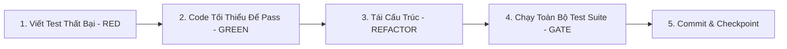

# Quy Chuẩn Phát Triển Theo Workflow Patterns & TDD

Tài liệu này chuẩn hóa quy trình phát triển theo kỹ năng **Workflow Patterns** cho dự án Văn Phòng Phẩm & Dịch Vụ Máy In, kết hợp chặt chẽ với các điều luật trong `AGENTS.md`.

---

## 1. Chu Trình TDD (Task Lifecycle: RED - GREEN - REFACTOR)

Mỗi tính năng hoặc tác vụ kỹ thuật mới **BẮT BUỘC** thực hiện tuần tự qua các bước:

1. **Bước 1 (RED):** Viết TestCase trước khi viết mã nguồn logic.
   - Thư mục: `tests/Feature/` hoặc `tests/Unit/`.
   - Bao gồm cả trường hợp hợp lệ (Happy path), trường hợp ngoại lệ (Edge case) và trường hợp lỗi (Error conditions).
   - Chạy test: Xác nhận test bị FAIL như kỳ vọng.
2. **Bước 2 (GREEN):** Viết lượng code tối thiểu trong Controller / Model / Service để test chuyển sang màu xanh (PASS).
3. **Bước 3 (REFACTOR):**
   - Tối ưu hóa hiệu năng, loại bỏ code trùng lặp (DRY).
   - Tách logic dùng chung vào `app/Helpers/AppHelper.php` hoặc `app/Services/`.
   - Chạy lại test: Đảm bảo vẫn PASS 100%.
4. **Bước 4 (Quality Assurance Gate):**
   - Chạy toàn bộ test suite dự án: `php artisan test`.
   - Tiêu chuẩn: **100% tests phải PASS** (hiện tại: 114/114 tests, 800 assertions). Không được để xảy ra bất kỳ hồi quy (regression) nào.
5. **Bước 5 (Conventional Commit):**
   - Format: `<type>(<scope>): <subject>`.
   - Các loại type: `feat`, `fix`, `test`, `refactor`, `docs`, `chore`.

---

## 2. Các Cổng Kiểm Soát Chất Lượng (Quality Assurance Gates)

Mỗi tác vụ trước khi được đánh dấu hoàn thành phải thỏa mãn 7 tiêu chí:

| Cổng kiểm soát | Yêu cầu bắt buộc |
| :--- | :--- |
| **1. Tests Passing** | 100% test suite phải xanh (`php artisan test` exited with code 0). |
| **2. Lean Dependencies** | Cấm cài package cồng kềnh nếu tự code dưới 50 dòng (theo Rule 3 `AGENTS.md`). |
| **3. Security & Anti-IDOR** | Chống IDOR tuyệt đối trên route công khai bằng `Mã + 4 số cuối SĐT`. |
| **4. Database Integrity** | Mọi biến động kho và tiền bạc bắt buộc bọc trong `DB::transaction(...)`. |
| **5. Database Agnostic** | Mã nguồn Eloquent phải tương thích đồng thời cả MySQL 9 (production) và SQLite in-memory (test suite). |
| **6. 100% Tiếng Việt** | Nhãn, nút bấm, thông báo lỗi, toast 100% tiếng Việt chuẩn mực. |
| **7. Mobile-First & Print** | Đáp ứng ngón tay trên di động (44px min) và in ấn chuẩn `@media print` A4/A5/K80. |

---

## 3. Lịch Sử Checkpoint Đã Hoàn Thành

| Giai đoạn | Mô tả | Mã Checkpoint SHA | Trạng thái |
| :--- | :--- | :--- | :--- |
| **Phase 1** | Trang chi tiết sản phẩm chuẩn SEO & Mobile Sticky Action Bar | `e1f9c14` | ✅ Đã kiểm duyệt |
| **Phase 2** | Thanh toán tự động kiểm tra VietQR thời gian thực & Khớp giá Flash Sale | `113f4cf` | ✅ Đã kiểm duyệt |
| **Phase 3** | Hệ thống Tra cứu toàn diện (`/tra-cuu`) đa năng chống IDOR & In ấn A4 2 liên, A5, K80 | `e27e1a4` | ✅ Đã kiểm duyệt |
| **Phase 4** | Bộ kiểm thử tự động `LookupSystemTest` & Xác thực toàn diện 114/114 tests | `e62ea25` | ✅ Đã kiểm duyệt |
